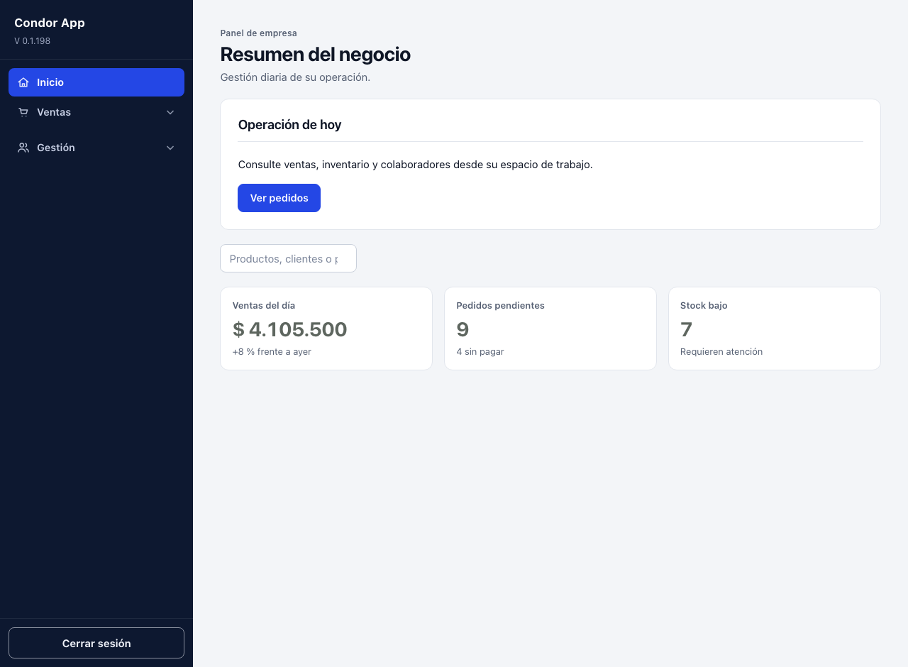
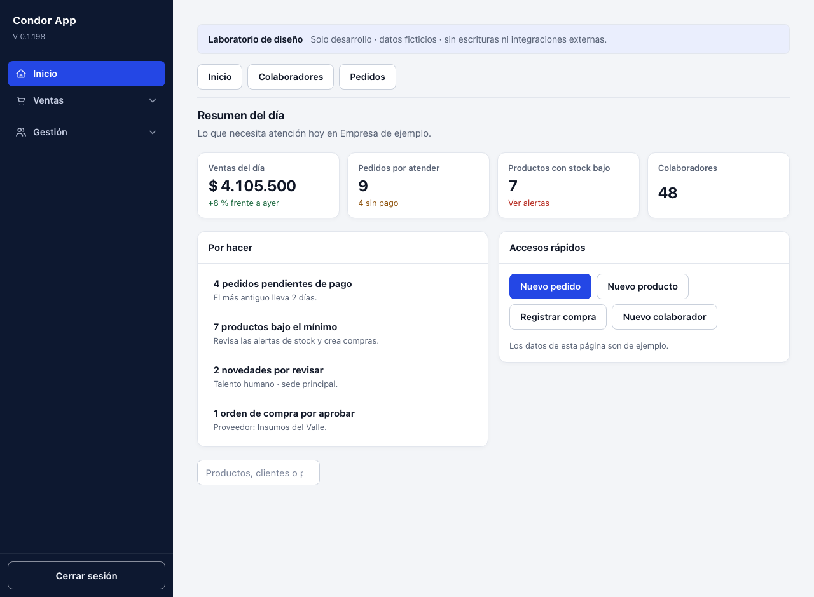
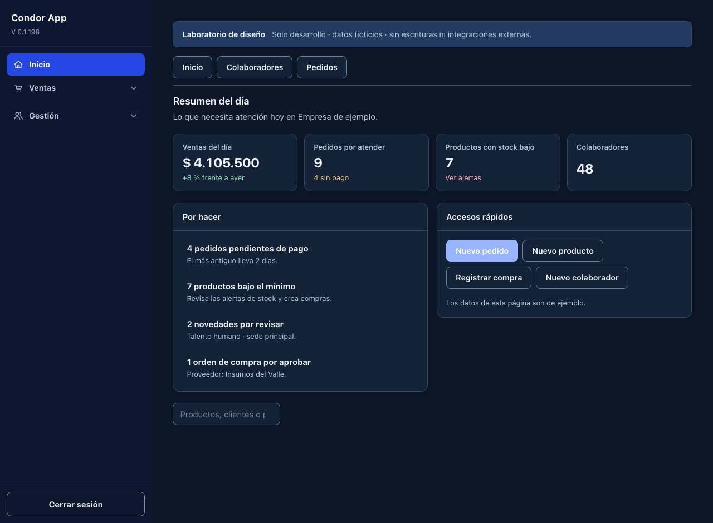

# DESIGN — sistema visual del administrador de Condor

> Guía de diseño del panel para aplicaciones de gestión empresarial · issue #1644.
> Fuente de verdad funcional: [PRODUCT.md](PRODUCT.md). Base existente: `frontend/admin/admin-ui.css` (issue #1643).

## Dirección y criterio editorial

**Personalidad:** sobria, técnica, cercana, ordenada. La interfaz comunica control y confianza, no espectacularidad. La cabecera de página define el trabajo; los números y estados tienen prioridad; las acciones primarias son inequívocas. El color se reserva para interacción y estados semánticos, no para adornar tablas.

**Jerarquía:** navegación persistente → ruta de módulo → título y descripción → indicadores → filtros → registros → detalle/edición en panel lateral. Un módulo por pantalla. Los registros tienen columnas comparables y encabezados visibles.

## Identidad y tokens

El CSS de referencia usa variables `--ui-*` bajo `.admin-shell`; no introduce un sistema competidor ni dependencias de red.

| Token | Claro | Oscuro (preferencia del sistema) | Uso |
| --- | --- | --- | --- |
| `--ui-bg` | `#f3f5f8` | `#0d1626` | Área de trabajo |
| `--ui-surface` | `#ffffff` | `#142238` | Tarjetas, tablas, diálogo |
| `--ui-surface-2` | `#f8f9fb` | `#1b2b45` | Superficie subordinada |
| `--ui-text` | `#0f1626` | `#f0f5ff` | Texto principal |
| `--ui-muted` | `#566073` | `#b7c7da` | Textos secundarios |
| `--ui-border` | `#e2e6ed` | `#344964` | Estructura |
| `--ui-brand` | `#2447e5` | `#98b4ff` | Enlaces y foco |
| `--ui-focus` | `#2447e5` | `#b5ccff` | Indicador visible de foco |

**Semántica:** `--ui-ok`, `--ui-warn`, `--ui-danger` y sus `*-soft` describen el estado, junto con texto. Nunca depender exclusivamente del color. Un CTA principal en oscuro usa azul profundo con texto blanco para preservar contraste.

**Tipografía:** pila del sistema `-apple-system, BlinkMacSystemFont, "Segoe UI", sans-serif`; mono del sistema para código. Título de pantalla 1.75rem, títulos de sección 1.125rem, cuerpo .9375rem, etiquetas .8125rem, indicios y metadatos .75–.8125rem. Números de indicadores alineados con `font-variant-numeric: tabular-nums`; encabezados con `text-wrap: balance`.

**Espaciado y volumen:** escala 4/8/12/16/24/32px; radio de controles 8px, tarjetas 12px y estado tipo píldora 999px. Sombras muy leves en tarjetas; bordes para separar información, no para decorar. Controles con objetivo táctil mínimo de 40–44px.

## Componentes y estados

| Pieza | Contrato | Estado alterno |
| --- | --- | --- |
| `PageHeader` | Título, descripción y acciones | Acciones ausentes no dejan hueco |
| `MetricStrip` | `<dl>`, indicador, cifra, pista opcional | Sin cifra inventada en API real |
| `Toolbar` | Filtros etiquetados, contador real | Filtro vacío / búsqueda sin resultados |
| `DataTable` | Tabla semántica con `<caption>` y encabezados | Vacío descrito, desplazamiento horizontal pequeño |
| `StatusPill` | Color + texto | Neutral cuando estado desconocido |
| `SidePanel` | `<dialog>` modal, Escape, teclado, foco devuelto | Cancelación sin persistencia |
| `Card` | Marco de trabajo sin significado inventado | Encabezado opcional |
| `OverviewGrid` | Grupo nombrado y números tabulares | La API decide carga/error |

### Patrones de página

**Panel de control:** título con contexto, métricas esenciales, tareas prioritarias y accesos a acciones reales. No usar estadísticas ficticias fuera de la demostración.

**Listado:** título/acciones → filtros → contador y tabla. Cabeceras accesibles; abrir un registro mediante botón nativo en la primera celda, no una fila clicable sin teclado. El vacío sugiere la acción siguiente.

**Detalle / alta:** panel lateral modal con foco gestionado por `<dialog>`; información en `<dl>` o formulario con `<label>`, mensajes cercanos y pie con cancelar/guardar. Guardar requiere API y permiso reales en módulos productivos.

### Accesibilidad y movimiento

- WCAG 2.2 AA: contraste, títulos ordenados, campos con etiqueta, `:focus-visible` persistente, sin navegación exclusivamente por hover.
- Para la navegación agrupada se conserva el acordeón CSS de Transitions.dev (`t-acc`); no hay listener de scroll ni cargas externas.
- Un pequeño stagger GSAP de 240ms en las métricas de **la demo** comunica la primera lectura. Usa `gsap.context()`, cleanup con `revert()` y respeta `prefers-reduced-motion: reduce`. Nunca bloquea contenido ni opera en producción.
- Panel lateral: entrada breve por transform y opacidad, sin movimiento cuando el sistema lo reduce. Transiciones interrumpibles para hover/foco, sin loops ni parallax.
- La opción oscuro aplica `prefers-color-scheme` en el shell, sin alterar los formularios públicos.

## Implementación y prueba manual

1. En un checkout de desarrollo, ejecutar `npm ci && npm run dev` (o el script de Vite de la aplicación) y abrir la ruta autenticada `/admin#design-preview`.
2. Comprobar navegación por Tab y Enter, cambio de pantallas de ejemplo, tabla filtrable, modal de detalle/alta y Escape con devolución de foco.
3. Probar el ancho 360px y 1280px, simulación de colores claro/oscuro, zoom 200%, texto largo y `prefers-reduced-motion: reduce`.
4. Capturar **pantallas reales** de antes y después en ambos temas en el PR. Si no existe un navegador autorizado en ejecución, registrar esa ausencia como evidencia pendiente; no generar capturas inventadas.
5. Comprobar que `npm run typecheck`, `npm run build:admin`, pruebas apropiadas y `CI Factory v1 / Validar` están verdes para el HEAD exacto.

## Límites

Los componentes nuevos son una referencia dev-only, nunca datos de negocio; no se altera la autenticación, roles, tokens CSRF, rutas del backend ni políticas de despliegue. El rediseño de módulos específicos queda fuera de #1644.

## Evidencia visual de #1644 — capturas de navegador

Las cuatro imágenes son capturas reales de Playwright Chromium a 1280 × 940, con React/Vite en checkouts locales aislados. La versión anterior corresponde a main@912f5348 (interfaz de #1643); la nueva corresponde al código fuente de ab47ae52 (el commit 4b274e6b solo reconcilia bundles generados). Las personas y métricas son datos sintéticos, no datos de clientes; no se alteró producción.

| | Claro | Oscuro del sistema |
| --- | --- | --- |
| **Antes** |  |  |
| **Después** |  |  |

**Nota:** el shell original no reaccionaba al tema oscuro del sistema; por eso las dos capturas "antes" tienen el mismo aspecto. Es una diferencia observada, no una captura ficticia.

**Comprobaciones locales:** typecheck y build:admin pasan; Playwright a 360 px verificó tabla filtrable, panel lateral con Escape y retorno del foco, cero errores JS y cero desbordamiento horizontal. Contraste medido de 13 pares texto/fondo de elementos presentes: mínimo 5,47:1 (claro), 6,51:1 (oscuro). La muestra no sustituye auditoría integral de accesibilidad.
