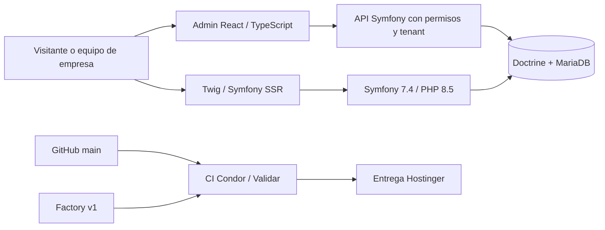

# Condor App

> Plataforma SaaS modular, multi-tenant y mobile-first para comercio, operación y administración.

**Rol en la fábrica:** producto independiente · **Fase:** construcción · **Roadmap:** [Issue #1](https://github.com/pl0n3r/Condor/issues/1)

Condor mantiene su código, datos, deploy y operación separados. Factory aporta gobernanza y contratos compartidos; ControlBot es el control plane y FactoryRunner el execution plane.

## Operational Cockpit

[](https://github.com/pl0n3r/Condor/actions/workflows/ci.yml)
[](https://github.com/pl0n3r/Condor/releases)

[GitHub Actions](https://github.com/pl0n3r/Condor/actions) · [GitHub Releases](https://github.com/pl0n3r/Condor/releases) · [Orquestador ControlBot](https://control.condorapp.com.co/)

Las insignias se actualizan desde sus fuentes vivas al abrir esta página, sin commits de refresco. La evidencia de `Validar`, salud, observación de despliegue y decisiones sigue en Actions, Issues y el Orquestador; esta portada no declara producción validada.

## Work Queue

- **NOW:** [#824 — migración del README a Contract v2](https://github.com/pl0n3r/Condor/issues/824) y [trabajos en revisión](https://github.com/pl0n3r/Condor/issues?q=is%3Aissue+is%3Aopen+label%3A%22estado%3A+en+revisi%C3%B3n%22).
- **NEXT:** [Issues críticos disponibles](https://github.com/pl0n3r/Condor/issues?q=is%3Aissue+is%3Aopen+label%3A%22prioridad%3A+cr%C3%ADtica%22+label%3A%22estado%3A+disponible%22), respetando reservas y dependencias.
- **LATER:** [Roadmap canónico #1](https://github.com/pl0n3r/Condor/issues/1) y [módulos operativos](https://github.com/pl0n3r/Condor/blob/main/docs/modulos-operativos.md).
- **BLOCKED:** [Issues bloqueados](https://github.com/pl0n3r/Condor/issues?q=is%3Aissue+is%3Aopen+label%3A%22estado%3A+bloqueado%22); cada Issue conserva la causa y condición de desbloqueo.

Las etiquetas y el roadmap son la autoridad de la cola; estos enlaces no son un segundo planificador ni una medida de progreso.

## Qué hace el producto

Condor App es un SaaS modular **multi-tenant** para empresas colombianas. En `main` existe código para ocho áreas operativas; «presente en código» **no** significa comercialmente disponible ni desplegado:

- **Catálogo, variantes y precios:** [CatalogController](https://github.com/pl0n3r/Condor/blob/main/src/Http/Controller/CatalogController.php) y [PricingController](https://github.com/pl0n3r/Condor/blob/main/src/Http/Controller/PricingController.php).
- **Tienda y checkout:** [StorefrontCheckoutController](https://github.com/pl0n3r/Condor/blob/main/src/Http/Controller/StorefrontCheckoutController.php); no implica pagos habilitados.
- **Pedidos y clientes:** [OrderController](https://github.com/pl0n3r/Condor/blob/main/src/Http/Controller/OrderController.php) y [CustomerController](https://github.com/pl0n3r/Condor/blob/main/src/Http/Controller/CustomerController.php).
- **Inventario por sede:** [InventoryController](https://github.com/pl0n3r/Condor/blob/main/src/Http/Controller/InventoryController.php).
- **Compras y proveedores:** [PurchasingController](https://github.com/pl0n3r/Condor/blob/main/src/Http/Controller/PurchasingController.php).
- **Producción y materiales:** [ProductionOperationsController](https://github.com/pl0n3r/Condor/blob/main/src/Http/Controller/ProductionOperationsController.php).
- **Reportes CSV tenant-safe:** [TenantCsvReportService](https://github.com/pl0n3r/Condor/blob/main/src/Application/Reporting/TenantCsvReportService.php).

Las pantallas y endpoints adicionales en [PRs abiertos](https://github.com/pl0n3r/Condor/pulls) siguen siendo preparación; la [guía de ocho módulos](https://github.com/pl0n3r/Condor/blob/main/docs/modulos-operativos.md) distingue lo existente de lo pendiente. El catálogo funcional integral permanece en [#802](https://github.com/pl0n3r/Condor/issues/802), sin confundir especificación con implementación.

## Arquitectura en 60 segundos



El backend valida permisos, sede y tenant, no la interfaz. Arquitectura y decisiones de negocio: [`ESPECIFICACIONES.md`](https://github.com/pl0n3r/Condor/blob/main/ESPECIFICACIONES.md). Gobierno de despliegues: [`AGENTES.md`](https://github.com/pl0n3r/Condor/blob/main/AGENTES.md).

## Stack e infraestructura

- **Backend y datos:** PHP 8.5, Symfony 7.4 LTS, Doctrine, MariaDB/MySQL; contratos en [`composer.json`](https://github.com/pl0n3r/Condor/blob/main/composer.json).
- **Admin:** React, TypeScript y Vite; frontend en [`frontend/admin/`](https://github.com/pl0n3r/Condor/tree/main/frontend/admin).
- **Público:** HTML SSR/Twig para SEO y experiencia móvil; [plantillas](https://github.com/pl0n3r/Condor/tree/main/templates).
- **Hosting:** Hostinger shared hosting; el deploy y su observación tienen gates propios, no se infieren de `main`.
- **CI / pruebas:** [CI Condor](https://github.com/pl0n3r/Condor/actions/workflows/ci.yml), contratos Python/PHP, PHPStan, Rector, TypeScript y Playwright según alcance.

## Ciclo de entrega

[Issue](https://github.com/pl0n3r/Condor/issues) → `/tomar` + reserva V3 → `trabajo/issue-N` → PR con claims y aceptación → [CI Condor / Validar](https://github.com/pl0n3r/Condor/actions/workflows/ci.yml) + Sonar/CodeQL + CodeRabbit FINAL → squash con puertas vigentes → verificación exact-`main` → observación y validación productiva cuando corresponda.

La identidad de release vive en [`config/version.php`](https://github.com/pl0n3r/Condor/blob/main/config/version.php). README Contract v2 **no** crea una segunda fuente de versiones, `/health`, avances ni readiness.

## Calidad y seguridad

- [Factory `PLAN-AGENTES.md`](https://github.com/pl0n3r/factory/blob/main/PLAN-AGENTES.md) gobierna reservas, decisiones, roles, CI y puertas humanas; [AGENTES.md](https://github.com/pl0n3r/Condor/blob/main/AGENTES.md) define la extensión local.
- Las APIs hacen cumplir aislamiento multiempresa y autorizaciones server-side; las pruebas deben demostrar rechazos cross-tenant y sin permiso.
- Migraciones de esquema solo aditivas/compatibles, backup previo y rollback cuando aplique. Ningún merge autoriza datos reales, gasto, deploy o go-live.
- `Validar`, seguridad automatizada y observación productiva son evidencias distintas: una insignia no convierte implementación en producción GREEN.

## Roadmap y fuentes de verdad

- **Plan y prioridad:** [Issue #1](https://github.com/pl0n3r/Condor/issues/1); [Issues](https://github.com/pl0n3r/Condor/issues) y [PRs](https://github.com/pl0n3r/Condor/pulls) para avance vigente.
- **Producto:** [`ESPECIFICACIONES.md`](https://github.com/pl0n3r/Condor/blob/main/ESPECIFICACIONES.md) y [guía de módulos](https://github.com/pl0n3r/Condor/blob/main/docs/modulos-operativos.md).
- **Operación:** [`AGENTES.md`](https://github.com/pl0n3r/Condor/blob/main/AGENTES.md), [`decisiones.yml`](https://github.com/pl0n3r/Condor/blob/main/decisiones.yml), [`datos.yml`](https://github.com/pl0n3r/Condor/blob/main/datos.yml).
- **Evidencia:** [GitHub Actions](https://github.com/pl0n3r/Condor/actions), [Releases](https://github.com/pl0n3r/Condor/releases) y [Factory@v1](https://github.com/pl0n3r/factory/tree/v1).

El README es una portada navegable, no un roadmap, tablero de progreso o histórico de decisiones.

## Desarrollo local

Instala dependencias PHP/Node según los archivos lock. Para esta adopción contractual:

```bash
python3 tests/test_readme_contract_adoption.py
python3 tests/test_release_identity_guard.py
```

Antes de entregar cambios PHP/tooling, Condor exige también PHPStan y Rector según AGENTES.md.

## Mapa de la fábrica

- **Factory:** governance/kit y contratos compartidos.
- **ControlBot:** control plane privado.
- **FactoryRunner:** execution plane autónomo.
- **AutoFactory:** herramienta local/manual separada.
- **Condor / GrindFlow / BRVTAL:** productos independientes.

La cola automática no altera estas responsabilidades.
